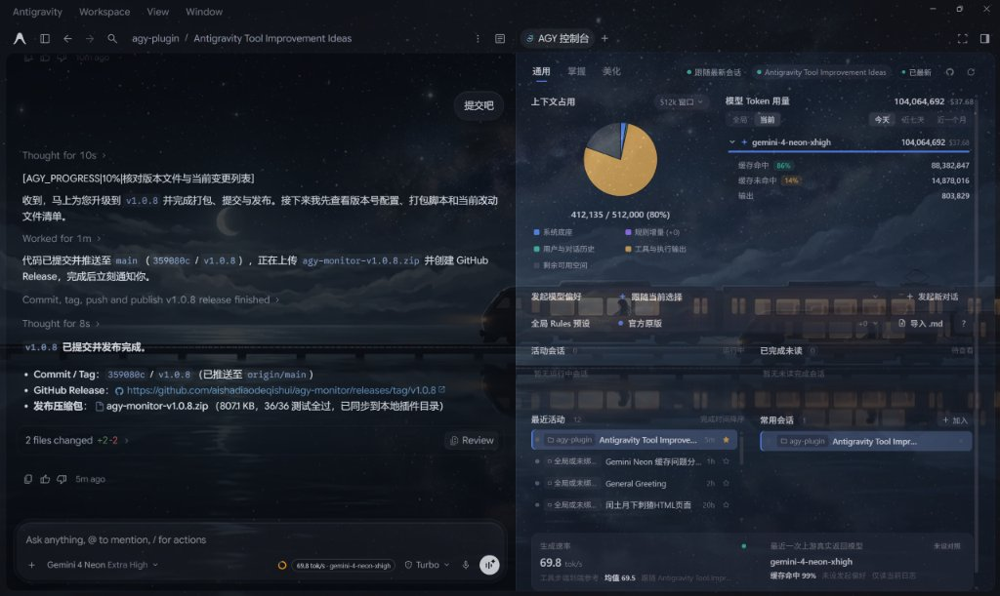
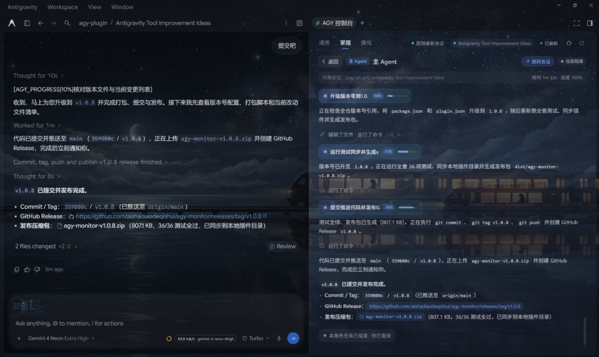
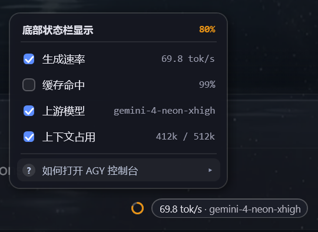
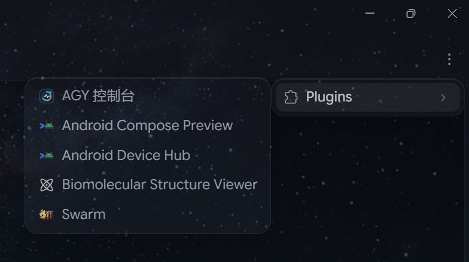
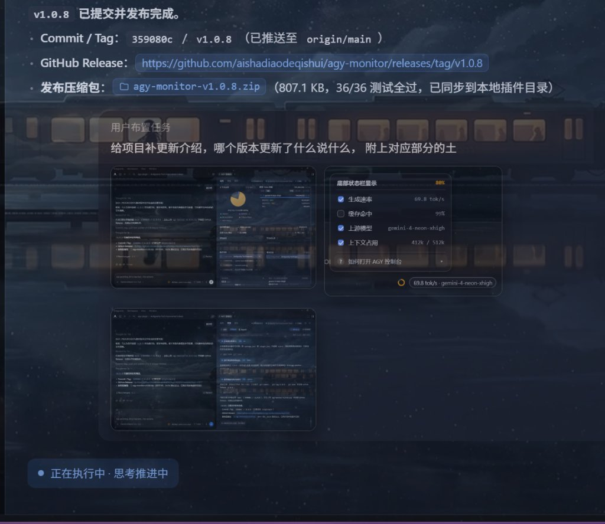

# AGY 控制台 (`agy-monitor`)

> 为 **Antigravity** 打造的零侵入侧边栏控制台插件：集 **实时遥测与配额分析（通用）**、**多 Agent 协作网与类 Codex 历程追踪（掌握）**、**撞色主题与整机壁纸/输入框圆环 HUD（美化）** 于一体。
>
> **零外部 npm 依赖** · **不修改 Antigravity 核心文件（`app.asar` / `config.json`）** · **开箱即用，改动自动保存**

---

## 核心功能

### 1. 通用（Telemetry & Sessions）
- **实时上下文饼图**：拆解系统底座、规则附加、对话历史与工具输出占比，支持 `256k / 512k / 1M` 窗口上限切换。
- **Token 消耗与原生 5h / 周配额看板**：按今日/7天/30天统计当前会话与全局各模型消耗与单次请求记录；免配置、免 CDP 静默直连官方本地语言服务，在模型用量正下方以三联圆环卡片实时展示 **Gemini / GPT&Claude / Argon** 的 5 小时与每周剩余配额百分比及精确重置倒计时。
- **实时生成速率与真实模型对照**：展示实时/平均 `tok/s`、Prompt Cache 缓存命中率，以及上游真实返回模型与前端选定模型的一致性核验。
- **会话管理与 Prompt 规则**：支持跟随最新会话/锁定会话、活动/未读/收藏会话一键切换，内置多套 Prompt 规则与自定义 Markdown 规则（带安全校验）。


### 2. 掌握（Multi-Agent Mastery）
- **会话进程总览**：按活动运行中、任务结束未读（翠绿）、任务结束已读（沉静灰）清晰分层，右侧进度环实时同步主 Agent 进度。
- **主次协作关系网**：自动读取本地 `subagents` / `swarm` / `messages` 数据，可视化呈现左主右次协作拓扑、主次往来箭头与次级协作连线。
- **类 Codex 内容历程**：点击任意主/次 Agent 即可进入多轮完整历程（运行中补充消息不清空历史），自动分类折叠操作组（运行了命令 / 编辑了文件 `+add -del` / 读取了文件 / 检索了资料 / 协同了子 Agent），支持安全 Markdown 渲染与文件芯片悬停预览。
- **双模式定时总结（默认关闭 · 按需开启）**：
  - **自身模型模式（每分钟 · 思维低）**：开启后通过官方 `PreInvocation` Hook 仅在尾部轻量化追加提示，几乎不破坏原会话 KV 缓存命中率；自动输出约 30 字开场思考与 10 字以内通俗进度总结；关闭后立即生效。
  - **第三方模型模式**：支持 OpenAI / Anthropic 双协议自定义接口、本机保存 API Key、实时拉取 `/models` 与连通测速。


### 3. 美化（Theme & Backdrop Studio）
- **撞色主题引擎**：内置「极昼原版」等 5 套精选方案，支持 6 项核心色自定义、方案保存、随宿主明暗自动反色。
- **图片壁纸 & Windows 整机壁纸**：内置 5 张高清壁纸（默认启用「星海夜行电车」），支持自定义上传图片、透明度/模糊度/暗度遮罩/圆角调节；Windows 下自动通过系统自带 `.NET` 编译轻量伴侣程序，提供 **方案一：贴背微透（默认 25%）**、**方案二：CDP 高清纯 CSS** 以及 **输入框上下文圆环 + 实时速度悬浮 HUD**（自动适配双屏多 DPI）。


---

## 版本更新日志（Changelog）

### `v1.0.12`（2026-11-22）— 桌面伴侣防崩与防闪黑加固、HUD 多会话实时同步与分屏防误隐

- **彻底根治主窗残留半透明透底、壁纸反复闪黑与弹窗重入崩溃**：
  - 修复 `OnWinEvent` 监听 `EVENT_OBJECT_HIDE / DESTROY` 漏校验 `CHILDID_SELF`（`idChild == 0`）与主窗真实可见性导致 Chromium 子元素隐藏误杀壁纸的问题；优化 `EVENT_OBJECT_REORDER` 为跳过不可见/透明/不重叠辅助窗（`IsDirectlyBehindVisible`）并加 80ms 防抖，纯 Z 序微调附带 `SWP_NOMOVE | SWP_NOSIZE`，消除壁纸反复黑屏与重排 CPU 飙高；同步前紧急保护收严至壁纸真正越界至主窗上方时才触发隐藏。
  - 修复点击底部上下文圆环弹窗时重入关闭引发的 `HwndSource ObjectDisposedException` 崩溃，补充 `_hudPopupOpening` 重入锁与非致命 UI 异常自愈。
  - 接入 Windows 电源休眠（`PowerModeChanged`）与锁屏（`SessionSwitch`）事件：休眠/锁屏前自动还原主窗 100% 不透明，唤醒解锁后自动重贴壁纸；新增 `--restore-opacity` 全桌面应急还原与真实 Win32 透明度核验补刷。
  - 桌面环境探测改用原生 `agy_backdrop.exe --probe-desktop`（~59ms 极速响应，永不缓存瞬态超时失败），Sidecar 新增 15 秒轻量伴侣看门狗断线自愈。
- **底部 HUD 与控制台多会话精准同步**：
  - 前景可见 AGY 控制台切换会话自动同步 HUD，常规轮询实时推送活跃前景会话速率与上下文占比，同时严格拦截后台隐藏 iframe 抢占。
  - 顶栏 UIA 标题探测新增真实会话白名单校验（`MatchesAnyKnownSession`），彻底杜绝聊天正文片段污染会话标题；单窗口切换会话自动清理陈旧窗口标题缓存。
- **分屏防误隐与窄输入框完整显示**：
  - 将 `console-fullscreen` 遮挡判定收严至真全屏宽度（>= 60%～62%），修复普通分屏切换至 Overview 后圆环被幽灵全屏误隐藏问题。
  - 窄输入框放不下完整模型 ID 时整段优雅收起模型名，避免半截断字。

---

### `v1.0.11`（2026-11-22）— 官方原生 5 小时与周配额三联圆环看板 & 顶栏等高锁定

- **原生官方 5 小时 / 周配额三联卡片**：
  - 无需开启 CDP、无需手动打开设置页，后端通过宿主注入的原生本地语言服务通道（`RetrieveUserQuotaSummary`）毫秒级静默拉取官方实时配额，自带 30 秒缓存、并发合并与失败陈旧兜底。
  - 在「上下文占用」右侧、「模型 Token 用量」正下方横向排布 **`Gemini`**、**`GPT&Claude`**、**`Argon`** 三张配额小卡片；每张卡片内上下排列「5小时」与「周额度」，左侧为按剩余比例自动变色（绿 / 琥珀 / 红 / 虚线灰）的 SVG 进度圆环，右侧上下双行清晰呈现名称、剩余百分比及动态刷新倒计时（悬停可看精确小数百分比、本地重置时刻与包含模型列表，点击卡片可立即强制刷新）。
- **顶栏双列等高锁定（展开模型列表不撑高页面）**：将右侧「模型 Token 用量 + 配额卡片」区域高度严格锁定为左侧「上下文占用」的精确高度，展开任意多个模型明细项时仅在列表区域内部滚动，彻底消除展开/折叠引起的布局跳动与底栏挤压。

---

### `v1.0.10`（2026-11-21）— 方案二侧边栏防叠色、WSL2 NAT 隧道加固与 6 项稳定性修复

- **方案二侧边栏防多层叠色**：`scanLayers` 改为由外向内反序遍历并自动清除嵌套后代重复 `sidebar` 标记（引擎升级 `v3` 自动热替换），避免侧边栏多层半透明叠加发灰遮挡壁纸。
- **WSL2 NAT 隧道与跨端路径加固**：监听 `close` 事件防止大响应提前截断并补全真实 WebSocket 隧道双向测试；隧道程序按源码哈希命名避免 Windows 升级文件锁；`toWindowsPath` 对尚不存在的路径自动回溯父目录转换。
- **WSL2 自更新与入口体验完善**：WSL2 一键更新后自动重编 Windows 贴背伴侣，顶栏 GitHub 入口自动调用 Windows 浏览器打开。
- **请求记录弹窗分页防越界**：翻页后刷新若总条数收缩，自动回退至最后一有效页并重拉。

---

### `v1.0.9`（2026-11-21）— Win + WSL2（含 NAT）全屏美化适配、单次请求记录明细弹窗与掌握页体验升级

- **Win + WSL2（含 NAT 模式）全屏美化完整适配（#1）**：
  - 自动识别 WSL2 + Windows Interop 环境并解除「仅支持 Windows」限制：支持**方案一（贴背伴侣）**自动跨端编译至 Windows NTFS 目录并静默拉起，心跳存活检测兼容 Windows PID。
  - **方案二（CDP 高清纯 CSS）**新增零管理员权限、零防火墙弹窗的 WSL2 NAT 免转发回环隧道（`agy_wsl_cdp_tunnel.exe`），无需开启 `mirrored` 模式即可自动桥接 Windows `127.0.0.1:<port>`。
  - 放行 WSL Remote 主窗口 `https://127.0.0.1:<port>/` Target（仍严格排除 AGY 控制台自身与其他本地服务），并升级 9×9 全边缘图层扫描与工作台壳层（含右侧栏、底栏、标签栏及浅色区域）透明覆盖。
- **单次模型请求记录明细弹窗**：「模型 Token 用量」新增 **`请求记录`** 入口按钮，弹窗完整展示每次请求的 10 项明细（时间、`model_id`、输入及缓存拆分、输出、缓存命中率、估算费用、首字、耗时、`tok` 速度、状态及异常报错详情），支持独立切换范围/时间/模型/状态筛选与分页浏览。
- **「掌握 → 会话进程」常用会话置顶与行内星标**：常用会话始终按原顺序置顶显示在最上方，每行支持一键设为常用或取消常用，并与「通用 → 常用会话」实时双向同步。
- **「掌握」页连续/行内图片并排展示**：正文行内嵌入的多个本地图片自动收束为紧凑图片芯片，并在行下并排排列为缩略图画廊，不再打断正文排版。
- **严格语义化版本更新检测**：仅当远端最新 Release 版本号严格高于本地版本时提示「有更新」，消除同版本文档提交或本地超前版本导致的误报。

---

### `v1.0.8`（2026-11-21）— 全屏多高度排版、窄栏分级压缩、全屏遮挡联动与性能内存优化

- **宽屏 / 全屏与多高度自适应排版**：宽屏居中收束（`1180px–1260px`）并加入轻毛玻璃卡片分层；「通用」配置行双栏并排、「掌握」页宽屏升级为左栏会话进程 + 右栏主次协作画布、「美化」页色调与示例区左右联排、壁纸改为 16:9 画廊与 4 列滑块、能力边界说明改为 3 列卡片；同时适配矮窗口紧凑与高屏舒展高度。
- **输入框过窄按长度分级压缩**：补全 `ComboBox / SplitButton / MenuItem` 与工具栏子树扫描及输入框容器左边界硬约束；空间不足时按优先级整段隐藏 Model ID → 缓存命中 → 速率，仅保留紧凑圆环（不再半截省略或溢出盖住模型下拉框）。
- **全屏控制台 HUD 几何联动**：控制台实时上报物理视口宽度，全屏控制台（含左侧边栏展开时）自动隐藏底部上下文圆环且鼠标按下不闪现，退出全屏毫秒级恢复。
- **全链路性能与内存优化**：桌面伴侣壁纸/灯箱流式解码限制 `DecodePixelWidth`、空闲工作集回收、冻结高频画刷、`UiaWorkerLoop` 分级休眠（后台零 COM UIA RPC）；Node 后端 SQLite 语句缓存、冷热会话分级扫描与 `mtime` 缓存；移除「掌握」页打开本地文件/目录成功后的多余提示弹窗。

| 通用面板 + 底部圆环 HUD + 整机壁纸联动 | 掌握页类 Codex 历程详情 + 跳转会话 + 进度胶囊 |
| :---: | :---: |
|  |  |

---

### `v1.0.7`（2026-11-21）— 底部状态栏勾选弹窗、悬停打开指引、双屏防覆盖熔断与中文配额避让

- **点击上下文圆环自定义显示项**：点击底部圆环或胶囊弹出配置菜单，支持自由勾选/取消 **生成速率 / 缓存命中 / 上游模型 / 上下文占用**，设置自动持久化且不抢主窗焦点。
- **「? 如何打开 AGY 控制台」悬停图解指引**：彻底移除模拟鼠标点击方案，改为移入弹窗底部入口即在侧边弹出清晰图示，一键看懂插件打开位置。
- **双屏 & Wallpaper Engine Z-Order 硬防线**：引入 `IsWindowStrictlyBehind` 严格后置校验与异常熔断机制，防止壁纸窗口在多屏/壁纸引擎环境下遮挡 Antigravity 主窗。
- **中文模型与配额弹窗避让**：补全 `使用限额 / 查看用量 / 重置于` 等中英文浮层检测与多点祖先链识别，展开模型/用量弹窗时自动隐藏圆环。

| 点击圆环弹出 4 项自由勾选配置 | 悬停「如何打开 AGY 控制台」弹出图解指引 |
| :---: | :---: |
|  |  |

---

### `v1.0.6`（2026-11-21）— GPU 硬件加速贴背、VSync 跟窗与 10 项上下文圆环精度修复

- **硬件加速贴背 & VSync 同步跟窗**：贴背层升级硬件加速渲染 + 原生 DWM 圆角，`BeginDeferWindowPos` 原子批量同步并接入 `CompositionTarget.Rendering` 实现跟手拖动；补充全局未捕获异常兜底自动还原主窗不透明度。
- **上下文圆环 10 项修复**：压缩 `CHECKPOINT` 摘要调用避免占比虚高、纯文本对话不再误借其他会话速率/模型、新建空白对话立即重置 `0%`、过滤 `[AGY_PROGRESS]` 进度标签噪音。

---

### `v1.0.5`（2026-11-21）— 子 Agent 实时状态、安全校验与多 DPI 稳定性加固

- 接入权威子 Agent 运行状态（长任务超过 90 秒不再误判结束），修复 `<thinking>` 思考内容泄露并补全 `replace_file_content` 精确 `+add -del` 行数统计。
- 强化本地路径安全策略（拒绝 UNC 路径、限制非图片可执行文件直开），按会话隔离 Hook 状态文件，修复混合 DPI 灯箱偏移与含逗号路径在资源管理器中的选中定位。

---

### `v1.0.4`（2026-11-20）— 定时总结默认关闭与状态竞态修复

- 定时总结功能改为默认关闭、按需一键开启；统一 `PLUGIN_DATA` 配置读取路径，修复会话中途开启总结无响应及开关轮询竞态问题。

---

### `v1.0.2` ~ `v1.0.3`（2026-11-20）— 「掌握」页内联图片预览与 100% 不透明原生全窗灯箱

- 在「掌握」页对话历程中自动提取并内联渲染清晰的本地图片预览网格；点击任意图片可在 Windows 下拉起 100% 不透明原生 WPF 全窗灯箱（支持滚轮缩放、拖拽平移、打开文件与定位所在目录）。



---

### `v1.0.1`（2026-11-20）— 顶栏一键自更新、GitHub 入口、跳转会话与防孤儿悬浮窗

- 顶栏新增自动检查更新/一键升级按钮与 GitHub 仓库快捷图标；「掌握」页总览与 Agent 详情页新增「跳转会话」按钮；修复重入导致的孤儿 HUD 悬浮窗并升级 Markdown 安全渲染。

---

### `v1.0.0`（2026-11-20）— 首个开源正式版

- 首发交付「通用（上下文饼图 / Token 消耗与 5h 配额 / 速率与模型对照 / 会话管理）」「掌握（多 Agent 协作关系网 / 类 Codex 内容历程）」「美化（撞色主题 / 二次元壁纸 / Windows 零侵入贴背伴侣与底部 HUD）」三大模块及全平台一键安装/卸载脚本。

---

## 最简单安装方式（三选一）

> **运行环境**：只需已安装 **Node.js >= 22.5.0**（Windows 双击安装器若检测到缺失会自动提示通过 `winget` 一键装好，无需手动配置）。

### 方式一：下载 Release 压缩包，双击即装（推荐 · 最无脑）

1. 前往 [Releases 最新版本页面](https://github.com/aishadiaodeqishui/agy-monitor/releases/latest) 下载 `agy-monitor-v*.zip` 并解压到任意文件夹。
2. 运行安装器：
   - **Windows**：直接双击根目录的 **`install.cmd`**
   - **macOS / Linux**：终端进入解压目录执行 `chmod +x install.sh && ./install.sh`
3. 打开 **Antigravity** -> 左侧 **Customizations -> Plugins** -> 打开 **「AGY 控制台 (`agy-monitor`)」** 开关即可使用！

### 方式二：终端一行命令安装（无需手动下载）

- **Windows (PowerShell)**：
  ```powershell
  irm https://raw.githubusercontent.com/aishadiaodeqishui/agy-monitor/main/scripts/install.ps1 | iex
  ```
- **macOS / Linux**：
  ```bash
  curl -fsSL https://raw.githubusercontent.com/aishadiaodeqishui/agy-monitor/main/install.sh | bash
  ```

### 方式三：Git Clone 安装（开发者）

```bash
git clone https://github.com/aishadiaodeqishui/agy-monitor.git
cd agy-monitor
node scripts/install.mjs
```

---

## 默认设置与自动保存

首次安装即自动启用以下精选默认配置，**你在界面中做的任何改动都会实时自动保存到本机 `~/.gemini/antigravity/plugin_data/agy-monitor/`，升级插件也不会丢失**：

- **通用**：简体中文、512k 上下文窗口上限、自动跟随最新会话
- **掌握**：定时总结默认关闭（可随时一键开启「自身模型」或「第三方模型」）、操作分组默认收起
- **美化**：极昼原版配色、壁纸「星海夜行电车」（透明度 100% / 模糊 0px / 暗度 0% / 圆角 10px / 铺满裁剪）、Windows 整机壁纸方案一（透显度 25%）与输入框圆环 HUD 开启

---

## 升级与卸载

- **升级**：重新运行 `install.cmd` / `./install.sh` / `node scripts/install.mjs` 即可覆盖升级，个人配置与 Prompt 规则完整保留。
- **卸载**：
  - **Windows**：双击 **`uninstall.cmd`**（或运行 `node scripts/uninstall.mjs`）
  - **macOS / Linux**：运行 `chmod +x uninstall.sh && ./uninstall.sh`
  - 默认保留你的个人配置与自定义壁纸目录；如需彻底清除数据，执行 `node scripts/uninstall.mjs --purge-data`。

---

## 开发与打包发布

```bash
# 运行全量单元测试（零外部依赖）
npm test

# 同步当前源码到本机 Antigravity 插件目录
npm run sync

# 打包可直接上传 GitHub Releases 的独立 ZIP（输出到 dist/）
npm run pack
```

---

## 零侵入安全说明

- 严格遵守 Antigravity 官方插件规范，仅安装在 `~/.gemini/config/plugins/agy-monitor`。
- **绝不修改** Antigravity 安装目录、`app.asar` 或宿主 `~/.gemini/config/config.json`。
- 所有本地会话与数据库均以只读方式读取，所有第三方 API Key 仅保存在本机 `plugin_data` 目录，绝不上传或外传。

## 社区支持

https://linux.do
